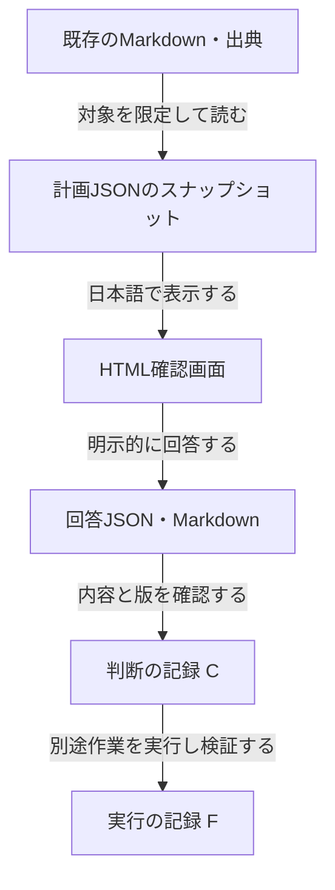

# HTML Plan JA

日本語で開発計画を読み、判断と根拠を残すための設計初版です。

**状態: 0.1.0 / 設計・画面見本。実用ランタイムとOKF接続は次の段階です。**

人は「何が変わるか」から読み、必要に応じて仕組み・対象ファイルへ進めます。AIには、出典と版を持つ構造化データを渡す方針です。既存アプリの画面・操作・保存データを変更するツールではありません。

## 今回あるもの

| 内容 | 状態 |
| --- | --- |
| 日本語の計画作成Skill・可搬プラグイン定義 | 作成済み。ホストへのインストールは未検証 |
| 仕様・計画/回答JSONの例・OKF接続契約 | 設計済み。自動変換は未実装 |
| 明暗テーマに対応する日本語画面見本 | 静的HTML。説明の開閉のみ動作 |
| 回答保存・コピー・JSON出力・復元 | 未実装。画面上にも表示 |
| OKFの読込、C/F記録への書戻し | 未実装 |

[画面見本のソース](preview/index.html)をダウンロードしてブラウザーで開けます。GitHubのファイル画面ではHTMLは実行されません。外部通信・CDN・依存パッケージはありません。

## 読む順番

1. [仕様と合格条件](docs/SPEC.md)
2. [データとOKFの接続契約](docs/DATA_CONTRACT.md)
3. [進捗・次回の開始点](PROGRESS.md)
4. [元ツールの評価と出典](docs/UPSTREAM_REVIEW.md)

## つながり



この流れの自動処理は未実装です。HTMLやJSONは確認用の派生物で、既存Markdownの正本を置き換えません。初期値や画面を開いたことを、採用・実装承認・実行完了とは扱いません。

## フォルダ

```text
plugin.json                    可搬プラグイン定義
skills/html-plan-ja/SKILL.md    日本語で計画を作る手順
skills/html-plan-ja/references/plan-template.md
                               手作業でも使える計画書式
preview/index.html             自作の静的な画面見本
examples/                      架空の正本・計画・回答例
schemas/                       計画と回答のJSON Schema草案
docs/                          仕様・接続契約・調査記録
scripts/check.mjs              公開パッケージの整合検査
PROGRESS.md                    状態・根拠・次回の作業
```

## 確認する

Node.js 22以上で、依存関係のインストールなしに実行します。

```sh
node scripts/check.mjs
```

これはJSONの構文・主要な相互参照・リンク・公開範囲の補助検査です。JSON Schema仕様全体への適合や、ホストへのインストール、実機合格を保証するものではありません。

## 由来と公開範囲

着想元は[コミュニティ版html-plan](https://github.com/anthropics/claude-plugins-community/tree/main/html-plan)です。本リポジトリは公式翻訳・フォーク・機能互換版ではありません。上流コード・CSS・Skill本文は同梱していません。第三者のライセンス表記の確認が必要な点は[調査記録](docs/UPSTREAM_REVIEW.md)に分離しました。

本リポジトリの新規作成部分は[MIT License](LICENSE)。公開サンプルは架空の情報だけです。実際の旅行データ、非公開コード、個人のパス、画像、認証情報を含めません。
